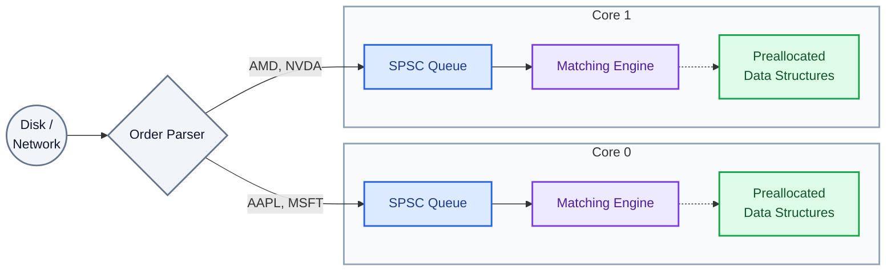

# Order Matching Engine

A C++23 exchange-style matching engine built to explore how order book design affects throughput. It accepts limit orders and cancellations, matches by price and arrival order, and maintains a separate book for each symbol.

## Architecture

A producer routes commands into SPSC queues. Each worker owns its books, so matching a symbol requires no shared book lock. The diagram shows the sharded design; the current profiling workload routes all commands to one shard for a controlled comparison.

## Measuring performance

V3, V4, and V5 preserve the same matching interface while changing the underlying book. Deterministic workloads make the versions comparable, and separate executables make it possible to profile each one. The benchmark measures the complete producer-to-worker path; a direct-book benchmark helps isolate matching and cancellation costs.

The [workload description](test-data/GENERATED_WORKLOAD.md) records the command sequence and timing boundaries. [Benchmark notes](V5/benchmarks/EXPERIMENT.md) contain the comparison method and results.
